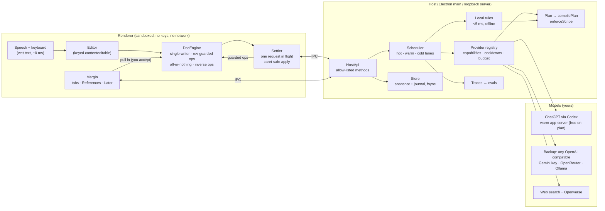

# Phlo: technical architecture

November 19, 2026. How Phlo is built, the guarantees it keeps, and what changes to support the MVP in `PRODUCT.md`. `ARCHITECTURE_REVIEW.md` has the research and measurements behind these choices.

---

## 1. Goals, in order

1. **Correctness.** Never lose a word, never move text under the caret, never let Scribe add words. These are invariants enforced in code. A prompt alone doesn't count.
2. **Latency.** Words show instantly. Settled ink within ~1.5 s typical, 3 s worst case.
3. **Cost.** $0 by default: your ChatGPT plan, on-device rules as a fallback. Paid calls are optional and capped.
4. **Swappable intelligence.** Any model can do any job if it passes the evals. Nothing in the product depends on one vendor.

Phlo runs on your computer, so "scale" here means **one person's tail latency and reliability.** Requests per second don't matter. Every design choice below follows from that.

## 2. The system



**One sentence:** the renderer owns the page; the host owns keys, models and disk; models only ever return a **plan**, and the plan is compiled into guarded ops that the engine accepts or rejects.

## 3. The three lanes

The core scheduling idea. Work is split by how long the person will wait for it, and the fast lane is never blocked by the slow ones.

| Lane | Jobs | Budget | Concurrency | If late or failing |
|---|---|---|---|---|
| **Hot** | Settle | ≤ 1.5 s typical, hard deadline 4 s | 1 in flight; newer words fold into the next request, or supersede it | Local rules place the words. Never blocks typing. |
| **Warm** | PHLO ASKS question, Phlo suggests, answers about References | ≤ 5 s | 1 | Silently skipped. These are offers, never required. |
| **Cold** | Look into, Ideas, find or make an image, Publish export | Seconds to a minute | Up to 3, separate model thread | Card says "Couldn't finish," with retry. |

**Rules:**
- Hot preempts everything. A cold job never shares a model thread with settling, so a 40-second research turn can't add a millisecond to settle p95.
- Cold results are **proposals**. They land in the margin as References and touch the page only when you pull them in, through the same `DocEngine.commit` path as everything else.
- Every lane is cancellable. Closing a draft cancels its jobs.

*Today:* the hot lane is built (Settler + Orchestrator with deadline, supersede and fallback). Warm runs inline. **The scheduler and cold lane are the main build for the MVP** (§8).

## 4. Invariants and where they're enforced

| Guarantee | Enforced by | Tested by |
|---|---|---|
| Model never writes HTML or touches the page | Plan schema (zod, structured output) → `compilePlan` → ops. Unknown ids dropped, never guessed. | `engine.test`, `benchmark.test` |
| A stale edit never overwrites newer typing | Every op carries `expectRev`; `DocEngine.commit` rejects the whole transaction on any mismatch | `benchmark.test` |
| Never lose a word | No op deletes user text; removals `park`, corrections fold into `trail` | `engine.test`, goldens |
| Text never moves under the caret | Caret block excluded from the request; a plan touching it waits | `e2e/acceptance` |
| Scribe adds nothing | `enforceScribe` (novelty ratio ≤ 0.2 vs. what you said) on every plan, from any model | `benchmark.test`, goldens |
| Undo only undoes that change | Each transaction stores its inverse; undo applies one inverse, guarded | `engine.test` |
| Keys never reach the page | Keys live in the host (OS keychain); renderer calls allow-listed `HOST_METHODS` only | Code review, CSP |
| Web content can't steer Phlo | References and research are data in prompts. Cold-lane models have no page-write tool; output is a proposal you accept. | To add with the cold lane |
| A crash loses nothing | Snapshot written, fsynced, renamed; append-only journal | `store` tests |

## 5. The settle path in detail

```
speech/typing ─► wet blocks (instant, light gray)
   │  end of utterance, Enter twice, ⌘↵, or moving away
   ▼
buildRequest: outline (ids, revs, headings) + wet words + speech hints
   │
   ├─ explicit command ("new section…", "rename…", "not X, Y")? ─► local rules, <5 ms
   │
   └─ otherwise ─► provider chain under deadline
          ChatGPT (warm Codex thread) → backup (if set) → local rules
   ▼
SettlePlan (JSON schema): placements · new headings · revisions · structure ops · question
   ▼
compilePlan ─► enforceScribe (Scribe) ─► rev-guarded ops ─► DocEngine.commit
   ▼
render: color to ink 280 ms, then glide 420 ms (FLIP), reduced motion respected
```

**Why it's fast:** the person sees words at ~0 ms, so model latency is ambient, not a wait. Commands skip the model. The plan is small (ids and short text, ~300 tokens), so output time is low. The warm Codex thread skips process start and keeps context server-side.

## 6. The model layer

**A registry of providers, each declaring what it can do:**

| Provider | Structured plan | Web search | Images | Cost | Role |
|---|---|---|---|---|---|
| ChatGPT via Codex (warm app-server) | ✅ outputSchema | ✅ Codex web search (verify live) | — | Free on your plan | Default for every lane |
| Local rules | ✅ deterministic | — | — | Free | Commands; fallback for settle |
| OpenAI-compatible backup (Gemini free key, OpenRouter, Ollama) | ✅ json_schema | — | OpenRouter only | Free to cents | Optional backup and comparisons |
| Claude (API key) | ✅ | ✅ | — | Paid | Optional |
| Openverse | — | — | ✅ find (openly licensed) | Free | Find a photo |

**Routing:** the scheduler asks for a *job* ("settle", "look into", "image"), and the registry picks the first healthy provider with that capability. Failures put a provider on cooldown (limit reached: 30 min; signed out: 5 min), so a dead provider costs one failed call, not one per settle.

**Budget governor (to build):** paid providers carry a monthly cap you set (default $0). The registry tracks spend from each response's usage and refuses to route past the cap. That's what makes "free by default" a guarantee and not a hope.

**Context windowing (to build):** send headings, the active section and recent blocks, not the whole draft. It keeps a 40-section draft as fast as a 4-section one.

## 7. Quality loop

Every change to prompts, rules or routing is judged by numbers, not by feel.

| Layer | What | When |
|---|---|---|
| Unit and benchmark | Engine invariants, compiler, forms, provider chain (48 tests) | Every commit |
| Goldens | 7 realistic sessions, 44 checks, any model (`npm run eval`) | Every prompt or routing change |
| e2e | Acceptance (9/9), the handoff design test, forms, expression | Before each push |
| **Replay (to build)** | Opt-in: a session's journal becomes a test case (redacted). "Undo right after a settle" marks a bad placement. | Weekly; grows the goldens from real use |

Current scores: local rules 82%, the best cloud model tried 87%. The ship bar is 90% on ChatGPT.

## 8. What changes for the MVP

In build order. Each is a commit with tests.

1. **Scheduler with lanes** (host). Priority queue per lane, cancellation by draft, a separate Codex thread for cold jobs. *~1 day.*
2. **Look into and Ideas** (cold lane). Voice intents → job → Codex turn with web search and a schema `{findings: [{text, source, date}]}` → References in the margin → pull in through `commit`. *~1–2 days.*
3. **On-device speech in the desktop app.** A small Swift helper using Apple's speech (macOS 26), whisper.cpp as fallback, streaming partial words as wet text. *~2 days.* Removes the last paid dependency.
4. **Budget governor and capability registry.** Replace the ordered chain with capability routing; add spend caps. *~½ day.*
5. **Context windowing.** *~½ day.*
6. **Publish export** to one self-contained HTML file and PDF. *~½ day.*
7. **Replay harness** from journals. *~1 day.*

## 9. Decisions on record

| Decision | Why | Revisit when |
|---|---|---|
| **The model proposes, deterministic code applies** | No corrupted text, cheap apply, any model can plug in | Never; it's the foundation |
| **Local-first, no Phlo server** | Free, private, fast; nothing to run or scale | Hosted Publish links (a static file host, not an app server) |
| **ChatGPT plan via Codex as the default model** | Free for you, good quality | Codex changes its interface, or terms rule out an app using it. Gemini and local are ready as fallbacks. |
| **No OpenRouter by default** | Costs money per call; your plan already covers it | Only for comparisons or images, with a cap |
| **Don't train our own model** | Plans are short and structured; local rules already pass 82%; no data yet | Replay has thousands of real sessions and a cheap model trails ChatGPT by > 5 points |
| **No CRDT or sync engine yet** | Single writer, single device. The op log is CRDT-shaped, so it can move later. | Multiplayer or multi-device |
| **No embedded browser** | Security surface and flow-breaking; a reader view covers it | Real demand for logged-in sources |

## 10. Risks

| Risk | Impact | Mitigation |
|---|---|---|
| Codex app-server changes or breaks | Settling drops to local rules (82%) | Version-pinned, falls back to `codex exec`, then backup, then local. Monitor in Your AI. |
| Using a personal ChatGPT plan inside an app you give other people | Each tester signs in with their own plan, which is fine for alpha. Not a public business model. | Before public launch: decide between BYO plan, a free Gemini key, and on-device models (§6). |
| Look into floods the margin or distracts | Breaks flow, the opposite of the point | Max 3 jobs, results quiet until done, nothing beeps |
| Prompt injection from web pages | A page tries to steer Phlo | Cold lane has no write tools; results are proposals; content quoted as data |
| Desktop speech quality on older Macs | Wrong words in, bad page out | whisper.cpp fallback; Chrome path stays |
