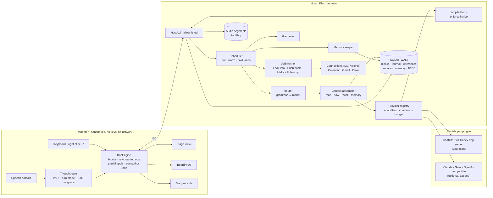

# Phlo: technical architecture

November 19, 2026. How Phlo is built to deliver `PRODUCT.md`. It covers the guarantees it keeps, where each one is enforced, and what it costs in milliseconds. `ARCHITECTURE_REVIEW.md` has the earlier research and measurements. The design for what users see is in `design/phlo-handoff/`.

---

## 0. The verdict, and what changed

The core shape was right and stays:
- One engine for voice, keyboard and AI.
- Stable block ids, and the model proposes plans that compiled code applies.
- Local-first, with no CRDT.

An outside review ("Phlo Living-Document Architecture: Principal Systems Recommendation", Nov 2026) agreed with that shape. Its two "this will break" warnings, a whole-draft version check and a single undo stack, don't apply to Phlo: we already check per block and undo per transaction.

What this revision adds, in order of impact:
1. **A thought gate:** settle on a finished thought, not on silence, with a grace window for "scratch that".
2. **Partial apply:** a plan's non-conflicting edits land even when one target went stale.
3. **Context assembled per request:** the cost of a settle stays flat at minute 60.
4. **A Memory keeper** that brings back the right earlier context without being asked.
5. **The Gardener:** whole-draft shaping, measured by fixes per session.
6. **One runtime for the four verbs**, on Codex threads, with connections through MCP.
7. **Immutable sources and provenance:** every line knows which words and which source it came from. That's also what Play needs.
8. **SQLite as the store:** full-text search for recall, and a transactional journal.
9. **A replay suite** that must pass 3 runs out of 3.

## 1. Goals and budgets

Scale here means **one person's tail latency and reliability**. Phlo runs on your computer; requests per second don't matter.

| Guarantee or budget | Target | Enforced or measured by |
|---|---|---|
| Words on screen after being heard | ≤ 150 ms | Speech partials render directly as wet blocks |
| Commands ("new section", "not X, Y") | ≤ 50 ms end to end | Grammar tier, on-device |
| Settle, end of thought to ink | p50 ≤ 1.5 s, p95 ≤ 3 s | Hot lane deadline 4 s, then local fallback |
| Settle at minute 60 vs minute 1 | within 10% | Fixed-size context (§8) |
| Fixes per session | median 0, p90 < 2 | Local telemetry (§14) |
| Lost words / text moved under caret / Scribe violations | 0 / 0 / 0 | Engine invariants, `enforceScribe` (§4) |
| Edits on the wrong block | < 1% | Replay suite |
| Sources altered | 0 | Sources are immutable (§3) |
| Phlo interrupting mid-thought | < 5% of cards | Pause gate (§10) |
| Cost by default | $0 | Budget governor (§12) |

## 2. The system



**One sentence:** the renderer owns the draft and is the only writer; the host owns keys, models, connections and disk; every model returns a **plan** addressed by block id, and plans become guarded ops that the engine accepts, partly accepts, or rejects.

## 3. Data model

Everything is a row with a stable id. Views (Page, Board) are projections; nothing is copied between them.

| Entity | Fields (essentials) | Notes |
|---|---|---|
| **Block** | `id`, `kind`, `text`, `rev`, `parent`/order key, `depth`, `wet`, `author` (you · phlo · verb), `mark`, `theme`, `trail[]`, `data` (table, chart, estimate, flow, make tree), `board {x, y, frame}` | `board` is view state: moving a card never changes reading order until "fold it back" |
| **Utterance** | `id`, `t0`, `t1`, `text`, `final`, `audioRef` | The transcript, time-coded; the ground truth for Scribe and Play |
| **Source** | `id`, `kind` (link, image, pdf, md, found), `title`, `url`, `contentHash`, `text`, `addedBy` | **Immutable** after capture. Phlo may quote and cite; nothing rewrites it |
| **Provenance** | `block → utterance[]`, `block → source[]` | Written by `compilePlan`; powers hover-to-hear, citations, Play, and the Scribe audit |
| **Connect** | `id`, `from`, `to`, `note` | A relation, not a block |
| **Theme** | `id`, `name`, `color` (cobalt, teal, saffron) | Max 3 per draft |
| **Card** | `id`, `kind` (ask, suggest, working, found, tangent), `anchor` block, `body`, `choices`, `state`, `createdAt` | Margin cards; resting cards move to Earlier from Phlo |
| **Job** | `id`, `verb`, `anchor`, `input`, `provider`, `status`, `budget`, `result` | One verb run |
| **Memory item** | `id`, `kind` (aim, instruction, entity, digest), `text`, `refs[]`, `editable` | Derived and rebuildable, except instructions you said, which are yours |

**Ops** (all carry `expectRev` where they touch an existing block): `insert`, `update`, `move`, `park`, `unpark`, `delete` (system only, never user words), `restore`, `meta`, `transcript`, `card.*`, `ref.*`, plus `connect.*`, `theme.*`, `board.place`, `memory.*`.

## 4. The engine: one writer, guarded ops

**Unchanged foundations (built and tested):**
- **Ops are checked per block.** A plan built against `rev 4` of block `b17` is rejected only if `b17` has moved on. Typing in another section never blocks it.
- **Commits are all or nothing.**
- **Every transaction stores its inverse,** so Undo reverses exactly one change and leaves later work alone.
- **The block with the caret is excluded from settling;** a plan touching it waits.

**New: partial apply.** Today one stale target rejects the whole plan, and the settler retries up to 3 times. Instead:
1. `compilePlan` emits ops in **dependency groups**: a new heading plus the words placed under it form one group; each revision is its own group.
2. `commit` checks each group. Clean groups commit together as one transaction; stale groups are dropped.
3. Words from a dropped group stay wet and fold into the next request. Nothing is lost, and nothing waits on an unrelated conflict.

The review calls for "rebasing" stale edits. We deliberately don't. A stale revision means you changed that block while Phlo was thinking, and your edit wins. Re-asking with fresh context is safer than transforming a model's edit onto text it never saw.

**New: per-author undo.** Each transaction records its author (you, Phlo settling, the Gardener, a verb). ⌘Z undoes *your* last change. The chips (`PHLO REORGANIZED 3 · UNDO`) and card actions undo Phlo's. Neither undoes the other's work.

## 5. Voice pipeline

```
mic → speech engine (partials) → wet blocks on screen (≤150 ms)
                     ↓ finals
              thought gate ── not finished ──► keep listening
                     ↓ finished (+600 ms grace)
              settle request (hot lane)
```

- **Speech engine.**
  - **Desktop:** Apple's on-device engine (SpeechAnalyzer, macOS 26), through a small Swift helper the app launches. It streams partials and finals over stdio.
  - **Fallback:** whisper.cpp or Parakeet for older Macs.
  - **Browser:** Chrome's Web Speech.
  - We pick by measuring word error rate on our own recordings of rambly thinking, not on benchmarks.
- **Thought gate.**
  - A voice-activity detector plus a small turn model (Smart Turn v3, ~8 MB, ~12 ms on CPU) score whether a thought is finished. A pause mid-thought ("the users are… parents of young kids") doesn't settle.
  - After a finished thought, a **600 ms grace window** lets "scratch that" or "no wait" fold into the same request instead of producing two conflicting edits.
  - The browser fallback is silence plus punctuation heuristics (today's behavior).
- **Audio is kept for Play,** in short Opus segments on disk, referenced by utterance id. You can turn this off; then Play shows text only.

## 6. Router: cheapest correct path first

| Tier | Handles | Cost |
|---|---|---|
| **Grammar** (`local.ts`, `intents.ts`) | New section, under X, rename, move, park, not X Y, scratch that, make that a…, fold, find a photo, chart with spoken numbers | < 1 ms, offline |
| **Model** | Placement, structure, Gardener plans, verbs | One structured call |

A middle tier (a small on-device classifier between dictation, structure and revision) is **deferred on purpose**. Add it only if traces show the model tier is often called for things grammar could have caught. Every tier we add has to earn its place in the evals.

## 7. Lanes and the scheduler

Work is split by how long the person will wait for it. The fast lane is never blocked by the slow ones.

| Lane | Jobs | Budget | Concurrency | Late or failing |
|---|---|---|---|---|
| **Hot** | Settle | ≤ 1.5 s typical, 4 s hard | 1 in flight; newer words fold in or supersede | Local rules place the words |
| **Warm** | Ask, Suggest, Gardener pass, contradictions | ≤ 8 s | 1 | Skipped silently |
| **Cold** | Verbs, Memory keeper digests, Publish export | Seconds to minutes | Up to 3 verbs and 1 background | Card says "Couldn't finish," with retry |

**Rules:**
- **Hot preempts everything.** Cold jobs run on separate model threads, so a 40-second Look into adds nothing to settle latency.
- **Every request has a `turnId`.** It's idempotent: a retry after a dropped connection never applies twice.
- **Closing a draft cancels its jobs.**
- **Per-provider concurrency caps,** so your ChatGPT plan isn't hammered by background work. Cold jobs back off while you're talking.

## 8. Context: a fixed-size packet, assembled every time

**Stateless requests, stateful store.** Every model call gets a fresh packet built from the store. We never pile onto one ever-growing thread. That keeps latency flat, makes every request replayable, and means switching models mid-session loses nothing.

| Part | Content | Size |
|---|---|---|
| **Instructions** | Role (Partner or Scribe), schema, standing instructions, the draft's aim | ~600 tokens, stable (prompt-cache friendly) |
| **Draft map** | Every section with id, path (`Study 2 › Methods`), a one-line digest, block ids and revs in the active section | ~800 tokens at any length |
| **Now** | The wet words, plus the last ~2 minutes of utterances | ~400 words |
| **Recall** | Top earlier utterances and blocks for what you just said (FTS5 BM25 plus the Ledger) | ≤ 600 tokens, only when triggered |
| **Sources** | Titles plus ordinal tags (`Source 2: Smith 2025`); quoted text only when cited | ≤ 400 tokens |

- **Recall triggers are deterministic:** "earlier", "I said", "go back to", "the X thing", a pronoun with no nearby referent, or a correction whose old value isn't in the active section. The Ledger answers "not forty, sixty" when the forty is twenty minutes back.
- **Embeddings are not in v1.** Add local embeddings only if replay shows lexical recall missing paraphrased callbacks.

## 9. Memory keeper

A separate process beside the settle path, inspired by Meta's Muse: it surfaces context *when it matters* instead of waiting to be asked.

- **Inputs:** finalized utterances and committed transactions.
- **Outputs**, as Memory items:
  - **Aim:** what this draft is for, inferred in the first minutes and revised rarely.
  - **Standing instructions:** "keep it to three pillars", "call them members". Detected by grammar and model, confirmed by an Ask card the first time.
  - **Ledger entities:** people, products and numbers, each with every place they appear.
  - **Section digests:** one line per section, rewritten when a section changes and you've moved on.
- **Push, not just pull:** when something you just said matches a Ledger entity from long ago, the keeper attaches it to the next settle request. A conflicting value (40% vs 60%) raises a contradiction Ask in Partner.
- **Visible and editable:** What Phlo remembers in the sidebar lists the aim, instructions and entities. Editing or deleting one changes what's sent from the next request on.
- **Rebuildable:** memory is derived from the journal and transcript, so a better model can recompute it at any time.
- **Scribe:** the keeper still runs, because recall improves placement, but nothing it produces is shown to the room.

## 10. The Gardener: whole-draft shaping

- **When it runs:** a warm-lane job at pauses (≥ 4 s of quiet), when you switch sections, or every ~3–5 minutes of activity. Never while you're mid-thought.
- **Input:** the draft map, digests, themes and aim.
- **Output:** a **structure-only plan**, using the existing structure ops: merge, move before or after, rename (from your own words), split, promote, retype (list to table).
- **Safety rules, in code:**
  1. Never touch the section holding the caret or the voice.
  2. Never move anything inside the viewport while you're speaking. Changes on screen wait for a pause and glide.
  3. Scribe: `enforceScribe` applies. Headings and renames must come from your words.
  4. At most one Gardener transaction per pass, authored `phlo`, undoable as a unit from its chip.
- **Learning loop:** a Gardener change you undo within 2 minutes is logged as a fix. Fixes per session is the quality metric for both settling and gardening.

## 11. Verbs: one runtime for Look into, Push back, Make, Follow up

| Verb | Tools | Output schema |
|---|---|---|
| Look into | Web search (Codex built-in), References read | `{findings: [{text, sourceUrl, title, date, quote?}]}` |
| Push back | Draft map, section text | `{asks: [{text, anchor}]}` (max 3) |
| Make | Draft requirements, existing pins | `{tree: WireframeNode}` (element ids, never HTML) |
| Follow up | Connections (Calendar, Gmail, Drive) | `{drafts: [{kind: invite\|email\|task, fields}]}` |

- **A job** is a verb plus an anchor block, its input, the provider, its budget and its permissions. It runs as a turn on a **dedicated Codex app-server thread** with a role prompt and an output schema, free on your ChatGPT plan. "With Claude" routes that one job to another provider in the registry.
- **Results are proposals:** Found cards, Ask cards, a Make block, or drafts awaiting approval. They enter the draft only through `DocEngine.commit` when you pull them in. Anything found or made is added to References as a Source.
- **Permissions:**
  - Read-only by default.
  - **Anything that leaves Phlo** (sending an invite or an email) needs an explicit confirmation on its card, every time.
  - Each verb only gets the connections it needs.
- **Untrusted input:** web pages, emails and files are data inside the prompt, delimited and labeled. A verb has no tool that writes to the page, so an injected instruction can at worst produce a bad proposal you can dismiss.
- **Later: guest agents.** Phlo exposes an MCP server so outside agents (Claude, a custom bot) can read a draft and submit proposals through the same card path. Same rule: proposals only.

## 12. Models, connections, budget

- **Provider registry:** each provider declares its capabilities (structured output, web search, latency class, cost). The scheduler asks for a *job*, and the registry picks the first healthy provider that can do it.
  - **Default:** ChatGPT through a warm Codex app-server (your plan).
  - **Fallback:** local rules for settling.
  - **Optional:** Claude, Grok, any OpenAI-compatible endpoint.
- **Cooldowns:** limit reached means 30 minutes off; signed out means 5 minutes. A dead provider costs one failed call, not one per settle.
- **Budget governor:** paid providers carry a monthly cap you set (default $0). Spend is tracked from each response's usage, and the registry refuses to route past the cap. This makes "free by default" a guarantee.
- **Connections:** MCP clients run in the host. OAuth tokens live in the OS keychain. Tools are allow-listed per verb. The renderer never sees a token.

## 13. Storage

**Move from JSON snapshot plus journal to SQLite (WAL).**
- **FTS5 is the Recall index.**
- **Utterances, sources, provenance and memory are relational** by nature.
- **WAL gives atomic multi-table commits** and crash safety without our own fsync dance.

**One database file for all drafts** (`phlo.db`, built-in `node:sqlite`, so no native rebuilds in Electron): drafts, journal (with author and inverse), and an FTS5 index; utterances, sources, provenance, cards, jobs and memory arrive as append-only migrations in the steps that need them. One file lets memory and Recall reach across drafts. Audio segments live beside it.

**Migration:** on first open, import the existing JSON snapshot and journal, then keep writing a JSON export on Publish, for portability.

The engine stays in the renderer and stays the single writer. The host persists each committed transaction (`version`, ops, inverse, author) in one SQLite transaction. A stale window can't overwrite newer work, because version checks are kept.

## 14. Quality loop

| Layer | What | When |
|---|---|---|
| Unit and benchmark | Engine invariants, compiler, partial apply, forms, router, provider chain | Every commit (`npm test`) |
| Goldens | Scripted sessions with checks, any provider (`npm run eval`) | Every prompt or routing change |
| **Replay suite** | Timestamped event streams: speech chunks, self-corrections, pastes, duplicate headings, simultaneous typing, dropped connections. **Pass 3 of 3 runs.** Gates: wrong-target < 1%, sources 100% kept, interruptions < 5%, settle p50 < 1.5 s, recovery < 100 ms | Text mode per commit on local rules; real models nightly |
| Long session | One 45-minute session with callbacks to minutes 3, 12 and 30 | Nightly |
| e2e | Acceptance checks, the design test, forms, expression | Before each push |
| **Fixes per session** | On-device telemetry: undo or move within 2 min of a Phlo change, retype of a settled line | Shown in Your AI; opt-in anonymous counts only, never text |

Real sessions become replay fixtures only by explicit opt-in, redacted.

## 15. Security and privacy

| Threat | Mitigation |
|---|---|
| A model writes something harmful to the page | It can't: plans only, compiled and guarded; unknown ids are dropped |
| Prompt injection from web pages, emails, PDFs | Delimited as data; verbs have no page-write tool; outward actions need a click on that card |
| Keys or tokens leak to the page | Keys and OAuth tokens live in the host keychain; the renderer only calls allow-listed methods; strict CSP |
| A connection does too much | Read-only by default; tools allow-listed per verb; confirmation every time for sends |
| Your thinking leaves your computer | Only to the model you chose, per request. Audio stays local. Telemetry is counts only, opt-in |
| Free provider trains on your data | Shown when you connect such a provider (for example a free Gemini key) |

## 16. Failure modes

| Failure | What you see | Recovery |
|---|---|---|
| ChatGPT limit or sign-out | Settling continues on local rules; Your AI says why | Cooldown, then retry automatically |
| A plan arrives after you edited its target | Only that part is dropped; your edit stands | Words re-asked in the next request |
| App crash mid-settle | Nothing lost: last committed version plus wet words | WAL recovery; `turnId` prevents double apply |
| Network drop during a verb | `LOOKING INTO` card shows "Couldn't finish" | Retry from the card |
| Speech engine unavailable | The dot shows it; typing still works | Fall back to whisper.cpp or the browser |
| A Gardener change was wrong | One chip, one Undo | Logged as a fix; feeds evals |
| Codex changes its protocol | Settling drops to local rules | Version pin, `codex exec` fallback, other providers |

## 17. Decisions on record, and what would flip them

| Decision | Why | Flip it when |
|---|---|---|
| The model proposes, deterministic code applies | No corrupted text, cheap apply, any model fits | Never; it's the foundation |
| Single local writer, no CRDT | One person, one device; schema safety; no tombstones | Multi-device offline editing in month 1 → Loro |
| Drop stale parts, don't rebase them | Your newer edit wins; re-asking beats transforming | Replay shows frequent wasted work from drops |
| Stateless requests over one long thread | Flat latency, replayable, provider-swappable | A provider offers cheap persistent context with equal latency and evals agree |
| Lexical recall before embeddings | Simple, fast, local, explainable | Replay misses paraphrased callbacks > 10% |
| No classifier tier yet | Grammar plus model covers it; fewer moving parts | Model tier handles > 20% grammar-catchable turns |
| Codex on your plan as default | Free, high quality | Terms or protocol rule it out; Claude, Grok, local are ready |
| Don't train our own model | Plans are small and structured; no data yet | Thousands of opted-in sessions, and a small model trails ChatGPT by > 5 points |
| No embedded browser | Security surface, flow-breaking | Real demand for logged-in sources |

## 18. Build order

Each step is a commit with tests, in the order of `PRODUCT.md`'s release plan.

**Alpha (the core loop)**
1. **SQLite store** and migration; per-author transactions. *~1 day*
2. **Partial apply** in `compilePlan` and `commit`, with dependency groups and tests from the benchmark. *~½ day*
3. **Scheduler with lanes**, `turnId` idempotency, cancellation. *~1 day*
4. **Context assembler:** draft map with paths and digests, Now, FTS5 Recall, Ledger. Plus the 45-minute golden. *~2 days*
5. **Memory keeper** and What Phlo remembers. *~1½ days*
6. **Margin card system** (one component, pause gate, stacking, Earlier from Phlo). *~1 day*
7. **Look into** on the verb runtime. *~1½ days*
8. **Apple speech helper and the thought gate.** *~2–3 days*
9. **Gardener** and the fixes-per-session metric. *~1½ days*
10. **Shapes:** live estimate, big number, pillars, cycle, ranking; marks and themes; drag to move; right-click parity. *~3 days*
11. **Replay suite** with pass^3 gates in CI. *~1½ days*

**Beta**
- Board view and Connect.
- Make with pins.
- Push back and Follow up.
- Calendar, Gmail and Drive over MCP.
- Reader view.

**Launch**
- Publish export and hosted links.
- Play from provenance and audio.
- "With Claude" routing for any verb.
- The budget governor exposed in Your AI.
