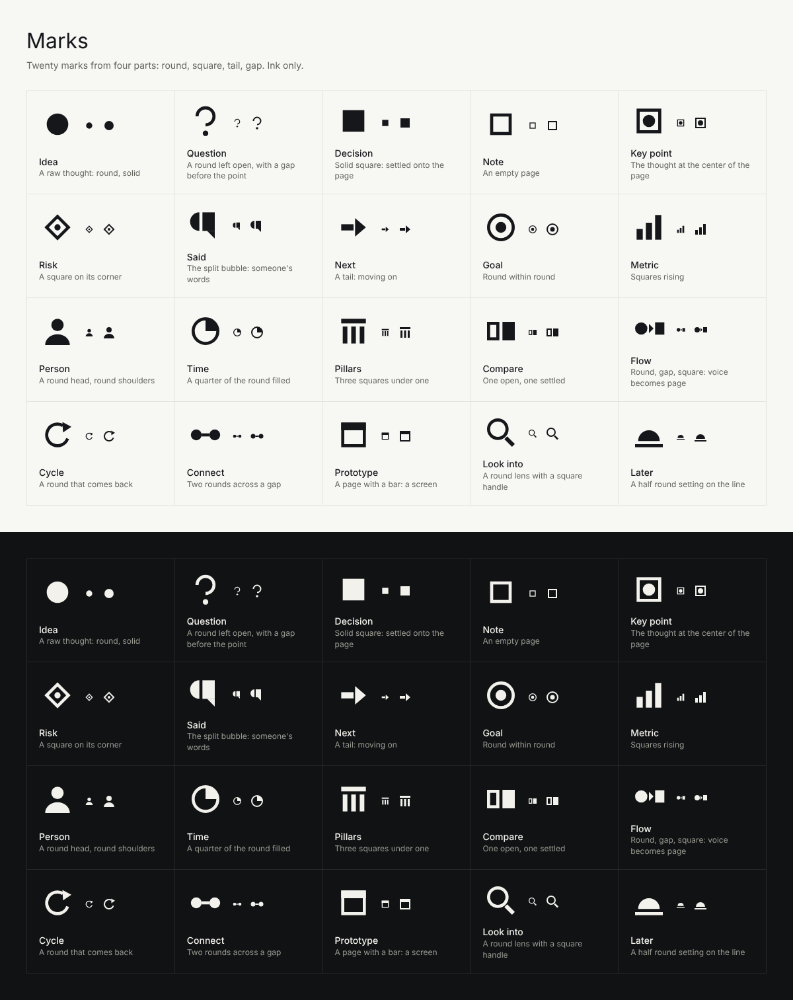

# Phlo: the expression system

November 19, 2026. A design proposal for how Phlo expresses ideas: few words to learn, many shapes underneath, all in one aesthetic. `EXPRESSION_FOUNDATION.md` is the full catalog of forms; this page decides how it's organized and how it feels. Scope and priority live in `PRODUCT.md`.

---

## 1. The principle: eight words, every shape

You should never browse a gallery of 60 chart types while thinking. **You say what you mean; Phlo picks the shape; you can always say a different one.**

So the system has **eight families**. Each is one word in the Add menu and one word you can say. The variants live inside the family, and Phlo chooses the variant from what you said.

| Family | Say | Phlo picks between | How it picks |
|---|---|---|---|
| **Text** | "heading", "list", "quote" | Heading, subheading, text, bullets, numbered, quote | Your cues: "first… second…" makes a numbered list |
| **Marks** | "that's a question", "key point" | Question, Idea, Decision, Note, Risk, Key point | The words: "should we…?" is a Question; "we decided" is a Decision; "that's really important" is a Key point |
| **Compare** | "compare these", "pillars" | Table, columns, pillars, pros and cons, 2×2 | Items with the same attributes become a table; 2–4 named themes become pillars; "on one hand" becomes pros and cons; two axes become a 2×2 |
| **Flow** | "flowchart", "steps" | Steps (1·2·3), linear flow, branching flow, cycle, timeline, funnel | "then" is linear; "if… otherwise" branches; "and back to the start" is a cycle; dates or quarters are a timeline; shrinking counts are a funnel |
| **Chart** | "chart that" | Bar, line, area, pie, histogram, scatter, stacked bar | The data: ordered time goes on a line; categories go on bars; parts of a whole (≤ 5, adding to 100%) make a pie; many raw values make a histogram; two measures per item make a scatter |
| **Map** | "connect this to pricing", "map it" | Connect (a link between two blocks), tree, mind map | One link draws a Connect; a parent with children makes a tree; ideas around a center make a mind map |
| **Make** | "wireframe this", "prototype it" | Wireframe, clickable prototype | Wireframe first; prototype once there are screens to click between |
| **Media** | "find a photo of…", paste a link | Photo, video, Figma, PDF, Markdown or HTML preview, image you upload | The link or file type |

**Switching is instant and lossless:** "as a pie", "make it a cycle", "turn that into pillars". The underlying content (items, values, sources) stays; only the shape changes. That's already how `turnIntoOps` works.

**Phlo's restraint is part of the taste:**
- A chart appears only with real numbers. No numbers, no chart, and Phlo says why.
- A pie only for parts of a whole. A line only for ordered x. These rules live in code, not just in the prompt.
- One suggestion at a time. If something reads like a sequence, Phlo *offers* a flow in the margin; it doesn't convert on its own.

## 2. Marks: meaning by shape, not color

Today's callouts are deliberately monochrome: a rule line for a Question, a solid bar for a Decision, a ring for an Idea. **I recommend keeping that and not going back to green questions and yellow ideas,** for three reasons:

1. **Color is earned in this brand.** Cobalt, teal and saffron mark *themes* (your ideas grouped). If questions are green and ideas yellow, color stops meaning anything, and the page starts to look like a sticky-note wall.
2. **Shape works everywhere:** Sumi, print, Published, color blindness, a 16 px margin.
3. **It's more distinctive.** Everyone does colored callouts. A page where meaning is carried by a small set of precise marks looks like Phlo and nothing else.

**The marks:** twenty icons drawn only from the symbol family's four parts (round, square, tail, gap), ink only. See `docs/design/proposals/marks/` (`preview.html`, `marks.png`).



- **Where they appear:** at the head of a Mark (Question, Idea, Decision, Note, Risk, Key point), on pillar heads, on Flow and Map nodes when it helps, and on margin cards. Nowhere else. They label a category; they're never decoration.
- **Who picks:** Phlo, from meaning ("the users" gets Person, "cost" gets Metric). You can change one by voice or click.
- **This is where generated images went.** For a page about ideas, a precise mark says more than an illustration. Making images moves to Make and Publish covers, later.

**Key point (highlight).** Say "that's really important" or "key point". The line gets the Key mark in the gutter and moves up one step in ink weight (Geist 500, the only place body text is heavier). Key points collect at the top of a Published piece as its summary. Highlighting does a job instead of just painting.

## 3. Phlo in the margin: one system for every chime-in

Every time Phlo has something for you (a question, a suggestion, research, a tangent), it uses **one component: the margin card.** One look, one set of rules, so it never feels like notifications.

**Anatomy**

```
 ▌ PHLO ASKS                                 ← mono label, tab-colored edge (Phlo touched this)
 ▌ Which comes first: the brief or the       ← one line, 14 words max
 ▌ calendar check?
 ▌ brief · calendar                          ← up to two choices, as text, never buttons
```

| Kind | Label | Comes from | Stays until |
|---|---|---|---|
| Ask | `PHLO ASKS` | Ambiguity that changes the result, or a stall in Partner | You answer, or you keep talking (it fades) |
| Suggest | `PHLO SUGGESTS` | "This reads like a cycle. Flow?" | Accepted, dismissed, or the section changes |
| Found | `FOUND · 3 SOURCES` | Look into, Ideas | Pulled in or dismissed; after you leave the section it shrinks to a chip |
| Later | `TANGENT · LATER` | "Oh also…" | Pulled in or moved to the Later list |
| Working | `LOOKING INTO · pricing` | An errand in progress | Turns into Found when it's done |

**Where it sits:** in the right margin, **aligned with the line it's about**, so you always know what it refers to. The sidebar is where cards go to rest (§3, "Earlier from Phlo"), not where they arrive.

**Answering, without stopping:**
- **Talk:** "the brief first", "yes, make it a cycle", "use the second one". Phlo matches your words to the card next to where you are.
- **Click** a choice, or the card to open it.
- **Ignore it.** Keep talking. An Ask fades when you resume; the card was an offer, not a gate. If the Ask was about ambiguity, Phlo goes with its best guess and puts a faint tab on that line so you can see and undo it.

**Stacking (the part that keeps it calm):**
- **One card per section.** A newer card replaces the older one, which drops into the sidebar.
- **Three on screen at most.** Beyond that, the margin shows a quiet count chip, `+2`. Click it to fan them out.
- **Nothing ever covers the page.** No modals, toasts that block, or sounds.

**Leaving:**
- **Dismiss:** hover and press Esc, or click the small ×. The card fades over 280 ms.
- **Time:** an Ask fades 2 minutes after it's ignored; a Suggest fades when its section changes. Found and Later never disappear on their own, because they're inputs you asked for. They shrink to a chip when you leave the section.
- **Earlier from Phlo:** everything that faded is kept in the sidebar under one heading, newest first, so nothing Phlo offered is lost.

**Scribe:** cards never appear on the room's screen. They wait privately in the sidebar.

## 4. Moving things around

What happened to you the other day (copy and paste to move a block) shouldn't happen.

- **Drag:** hovering a line shows a grip beside the **+**. Drag it; other blocks part to show where it lands. Drag a heading and its whole section comes with it.
- **Keys:** ⌥⇧↑ / ⌥⇧↓ moves the block you're in. Select several lines with ⇧-click and move them together.
- **Voice:** "move that under Users", "put goals first" (built).
- Every move is one `move` op through `DocEngine.commit`, so it's undoable and can't collide with settling.

## 5. Map view: how your ideas connect

The Obsidian-like view, Phlo's way. Like Room view, it's a **view of the draft, not a block in it.**

- Say "show me the map" or choose ··· → **Map view**.
- **Nodes:** sections as large rounds, key points and marks as small ones, with their marks. **Lines:** your Connects, plus links Phlo found (the same person, number or idea mentioned in two places), shown fainter and labeled as Phlo's.
- **Themes get their idea colors here** (cobalt, teal, saffron). Map view is where color is earned.
- Click a node to jump to it. Drag between nodes to Connect them.
- Later: a map across all your drafts.

## 6. Make: wireframes you can talk to

The loop you described, made precise:

1. **Make it.** "Wireframe the morning brief." Phlo builds a wireframe from the requirements in the draft. It's a structured tree of elements with ids, never model-written HTML, like every other block.
2. **Talk to it.** While it's on screen, say "the header needs today's date", "this list is too long, three items max". Each note becomes a **numbered pin on the exact element**, with your words beside it, in the margin-card style.
3. **Next pass.** Say "update it" (or press ⌘↵). Phlo rebuilds the wireframe with the pins as instructions. Resolved pins fold into the wireframe's trail, the same as `EARLIER:` on text, so you can see what changed and why.
4. **Prototype.** "Make it clickable" links the screens.

Pins address element ids, so this uses the same plan → compile → guarded ops path as settling.

## 7. Bringing the world in

Everything that comes from outside is a **Reference**: one noun, whatever the source. How it shows depends on what it is.

| Comes in as | Shows as | In the page as |
|---|---|---|
| A link to a page | Reader view in the sidebar | A cited line, or a source on a claim |
| PDF, Markdown, HTML | Preview in the sidebar | Quoted lines with their source |
| YouTube, Loom, Vimeo | Player | Video block (built) |
| Figma | Live frame | Figma block (built) |
| Look into results | A Found card with sources | Cited lines you pull in |
| Connector data (Amplitude, Sheets) | A small table preview | A Chart that remembers its query and can refresh (later) |

**Who does the research:** Look into runs on your ChatGPT plan through Codex web search. Antigravity is an app, not something Phlo can call, so "tag in Gemini" would need a Gemini API key. That's possible later as a second researcher, if you want one.

## 8. The design test for every new shape

Before anything joins the system, it passes all five:

1. **One word.** It fits in an existing family, or it isn't worth a ninth.
2. **Sayable.** You can ask for it out loud in under five words.
3. **Earned.** It shows only when the content supports it (numbers for charts, steps for flows).
4. **Lossless.** Switching it to another shape keeps every word and number.
5. **Quiet.** Paper and ink, hairlines, marks from the four parts. Color only for themes.

## 9. A real session, end to end: the morning chief of staff

Your example this morning, as Phlo should handle it. This becomes golden scenario 8.

| You | Phlo |
|---|---|
| "Okay, my morning today. I wake up, check Slack, then email, then three newsletters, then calendar, then I start work." | Steps settle as a **Flow** (linear), titled "Morning today" |
| "The problem is newsletters aren't experiential. I'm just reading." | A **Question**? No: a statement. It settles as text under a new section, "Problem" |
| "That's really the key point." | The line becomes a **Key point** |
| "What I want is a chief of staff that comes at me and we iterate by voice." | Section "The idea" |
| "Requirements. One, it knows my calendar. Two, it reads my newsletters for me. Three, I can talk back." | Numbered list under "Requirements" |
| "Look into what a chief of staff actually does in the first hour." | `LOOKING INTO` card, then `FOUND · 3 SOURCES` beside Requirements |
| "Use the second one." | A cited line joins Requirements |
| "Wireframe the morning brief." | A **Make** wireframe from the requirements |
| "The header needs the date. And the newsletter part should be three cards, not a list." | Two pins on the wireframe |
| "Update it." | New pass; pins fold into its trail |
| "Show me the map." | Map view: Morning today → Problem → The idea → Requirements → Wireframe |

Ten minutes of talking, no mouse, and you have a flow, a framed problem, cited requirements and a wireframe that took your notes.
